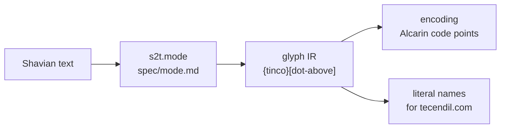

# shavian2tengwar

A command-line converter that turns Shavian text (`U+10450`–`U+1047F`) into Alcarin Tengwar Private Use Area code points (`U+E000`–`U+E07F`), using Shavian as a phonemic intermediate representation.

## Overview

English spelling is not phonetic, so converting it straight to Tengwar is full of context and guesswork. `shavian2tengwar` starts from Shavian instead. A Shavian letter is a sound, so each Shavian word maps to Tengwar by fixed rules, with no help from English spelling. To get Shavian from English, use a converter such as _Shave_.

The rules live in a specification, not in the code:

- [`spec/mode.md`](./spec/mode.md): the phonemic English Tengwar mode. Every rule has an ID, a status and its IPA, and the code is held to it.
- [`spec/encodings/alcarin.md`](./spec/encodings/alcarin.md): which Alcarin code point each glyph name maps to.
- [`corpus/`](./corpus): short phrases and minimal pairs that double as the test suite. Open [`corpus/review.html`](./corpus/review.html) to see every one rendered in Tengwar.
- [`docs/adr/`](./docs/adr/README.md): why each rule and structure was chosen, and how to revert it. [`docs/ROADMAP.md`](./docs/ROADMAP.md) shows what is in progress.

For the reasoning behind the deviations from community norms, see [docs/philosophy.md](./docs/philosophy.md). For a visual guide to the glyphs and marks, see [docs/language-guide.md](./docs/language-guide.md). The PDF versions of those two documents are built from the Markdown. After editing either one, rebuild its PDF with `npm run pdf` (see [Building the PDFs](#building-the-pdfs)).

### Key features

- **No dependencies.** Python 3.14 standard library only (see `pyproject.toml`; `.python-version` pins it for pyenv and uv). Every command here uses `python3`, so `python3 --version` must say 3.14 or newer; on macOS, `brew install python@3.14` and put it first on your `PATH`, or use pyenv or uv. Older Pythons stop with a one-line message.
- **Stream-oriented.** Reads stdin or an argument; writes stdout. Non-Shavian text (Latin letters, spaces, emoji) passes through. Verbatim `{{...}}` blocks are kept, or unwrapped with `--strip-escapes`.
- **Glyph names for Tecendil.** `--format literal` prints names like `{tinco}[dot-above]`, which you can paste into [tecendil.com](https://www.tecendil.com/).
- **Rule-by-rule inspector.** `--inspect WORD` shows each step with the spec rule IDs that fired.
- **Ready for more fonts.** The mode is written in font-independent glyph names; Alcarin is the one encoding so far (`--encoding`).

---

## Repository structure

```text
.
├── shavian2tengwar.py        # command-line front end
├── s2t/                      # the engine
│   ├── mode.py               #   the phonemic mode: Shavian word -> glyph cells
│   ├── stream.py             #   words, punctuation, {{escapes}}
│   ├── glyphs.py             #   glyph IR (Cell) and literal notation
│   └── encodings/alcarin.py  #   glyph name -> Alcarin code points
├── spec/
│   ├── mode.md               # the rules
│   └── encodings/alcarin.md  # the code point table
├── corpus/                   # test cases (README.md explains them); review.html is the visual reference
├── tests/                    # unittest suite
├── tools/
│   ├── corpus.py             #   reads corpus/*.md (used by the tests and render_corpus.py)
│   ├── render_corpus.py      #   regenerates corpus/review.html
│   └── build_pdfs.py         #   builds the PDFs of the two guides and corpus/review.pdf
├── docs/
│   ├── language-guide.md/.pdf  # visual guide to the glyphs and marks
│   ├── philosophy.md/.pdf      # why the mode deviates from community norms
│   ├── adr/                    # decision records (why things are the way they are)
│   ├── projects/               # one folder per piece of work: README, TASKS, LOG
│   └── ROADMAP.md              # what is in progress
├── AGENTS.md                 # instructions for AI agents (CLAUDE.md imports it)
├── pyproject.toml            # Python floor (3.14) and ruff settings
├── package.json              # npm scripts: test, corpus, corpus:view, pdf
└── .github/workflows/        # CI: runs the tests on Python 3.14
```

---

## How it works



A word becomes a list of _cells_, each one base glyph with its marks. The mode follows these ideas; the spec has the full rules.

- **Vowel marks sit above, and are read first.** A short vowel is a mark on the _next_ consonant; a vowel with no consonant after it sits on a short carrier (`{telco}`).
- **Long vowels always use the long carrier.** FLEECE, PALM, THOUGHT and GOOSE are `{aara}` plus a mark. Length is never written by doubling a mark.
- **Short and long vowels share a mark.** KIT/FLEECE, TRAP/PALM, LOT/THOUGHT and FOOT/GOOSE use the same mark; the long one sits on the long carrier. STRUT (grave) and the schwa (breve, `U+E053`) have marks of their own.
- **R is always rómen.** The R-vowels (𐑸 𐑹 𐑺 𐑽 𐑻 𐑼) are expanded to vowel + 𐑮, and óre is not used.
- **Diphthongs put the glide last.** `{anna}[acute]` reads /e/ then /j/. 𐑾 is 𐑦𐑩 and 𐑿 is 𐑘𐑵.
- **A schwa is always written**, so a consonant cluster is never mistaken for a schwa between consonants.
- **Nasal bar and gemination bar** mark nasal-plus-stop (`𐑯𐑑`, `𐑥𐑐`, `𐑙𐑒`, ...) and true double consonants.
- **Silmë and Essë flip** to their nuquerna forms when a mark lands on them.
- **Shorthands.** _the_, _of_ and _and_ have the Appendix E shorthands. _to_ and _for_ are written as weak forms (/tə/, /fər/).

---

## Font and rendering requirements

Displaying the output needs a font with Alcarin's code point layout. Alcarin's layout is not Everson's and not CSUR; a font built for those will show the wrong glyphs.

- **Recommended font:** [Alcarin Tengwar](https://github.com/Tosche/Alcarin-Tengwar) (Toshi Omagari / Tosche). It positions marks with native OpenType `mark` / `mkmk` features, which most text engines (including macOS apps, VS Code and browsers) handle.
- **Not Tengwar Telcontar:** it relies on SIL Graphite for mark positioning, which most editors and terminals don't run for Private Use Area characters, so every mark shows as a dotted circle.

---

## Usage

```bash
# a string argument
python3 shavian2tengwar.py "𐑦𐑯 𐑩 𐑣𐑴𐑤 𐑦𐑯 𐑞 𐑜𐑮𐑬𐑯𐑛 𐑞𐑺 𐑤𐑦𐑝𐑛 𐑩 𐑣𐑪𐑚𐑦𐑑"

# a pipe
echo "𐑢𐑦𐑯𐑑𐑼" | python3 shavian2tengwar.py

# glyph names, to paste into tecendil.com
python3 shavian2tengwar.py --format literal "𐑞 𐑚𐑸𐑛, 𐑯 𐑦𐑟"
# {the-shorthand} {umbar}{aara}[triple-dot-above]{roomen}{ando}{pusta} {and-shorthand} {esse-nuquerna}[dot-above]

# unwrap {{verbatim}} blocks
python3 shavian2tengwar.py --strip-escapes < in.md > out.md
```

### Inspecting a word

```bash
python3 shavian2tengwar.py --inspect "𐑢𐑦𐑯𐑑𐑼"
```

```text
=== INSPECTING WORD: '𐑢𐑦𐑯𐑑𐑼' [Encoding: alcarin] ===
  𐑢  ->  {vala}   [C-01]
  𐑦  queued: a vowel mark waits for the next consonant (V-01)
  𐑯𐑑  ->  {tinco}[dot-above][bar-above]   [N-01, V-11, V-01, K-01]
  𐑩  queued: a vowel mark waits for the next consonant (V-01)
  𐑮  ->  {roomen}[breve]   [L-06, R-01, V-14, V-01]
Glyphs:      {vala}{tinco}[dot-above][bar-above]{roomen}[breve]
Code points: U+E015 U+E000 U+E050 U+E044 U+E020 U+E053
```

The inspector also prints the converted word itself, as the "Output" line.

---

## Testing

```bash
python3 -m unittest discover -s tests -t .      # or: npm test
```

- `tests/test_corpus.py`: every row of `corpus/*.md` must produce its stated glyphs, and every rule it cites must exist in the spec and actually fire.
- `tests/test_coverage.py`: every adopted or provisional rule in `spec/mode.md` must be cited by some corpus row.
- `tests/test_identities.py`: two different Shavian spellings may only give the same glyphs where the spec declares them identical (the ligatures and the diphthong identities).
- `tests/test_encoding.py`: the Alcarin table must match `spec/encodings/alcarin.md`, and cover every glyph name the mode uses.
- `tests/test_spec_tables.py`: the engine's consonant, ligature, weak-form, word-sign and punctuation tables must match the tables in `spec/mode.md`.
- `tests/test_stream.py`: `{{...}}` escapes, every punctuation mark, quote alternation, error paths, and the `parse_literal`/`to_literal` round trip.
- `tests/test_cli.py`: the command line, including stdin, exit codes, the UTF-8 guarantee and a closed pipe.
- `tests/test_review_sheet.py`: `corpus/review.html` must be current. Regenerate it with `npm run corpus`.

The tests need Python 3.14. GitHub Actions runs them on every push (`.github/workflows/test.yml`).

To change a rule, edit `spec/mode.md`, then the engine, then add or update corpus rows, and record why in an ADR (`docs/adr/`).

---

## Building the PDFs

`docs/language-guide.pdf`, `docs/philosophy.pdf` and `corpus/review.pdf` are built by `tools/build_pdfs.py`. The two guides go from Markdown to HTML with markdown-it-py; the corpus review sheet comes from `tools/render_corpus.py`. Both are then printed by Chrome through Playwright (the same engine Obsidian prints with). The PDFs embed their fonts, so they can be shared with people who have none of them installed.

```bash
npm run setup:docs                           # once: makes .venv and installs the dependencies
npm run pdf                                  # or: .venv/bin/python tools/build_pdfs.py
.venv/bin/python tools/build_pdfs.py --out-dir build/   # write elsewhere instead of over the committed PDFs
```

- It needs Google Chrome installed (or `--browser PATH`).
- Text uses the font stack **Courier, Bernie Sans Beta, Alcarin Tengwar**, falling back one glyph at a time: Latin in Courier, Shavian in Bernie Sans Beta, Tengwar in Alcarin. All three must be installed, or load a file with `--font "Alcarin Tengwar=/path/to/AlcarinTengwar-Regular.otf"`. The script warns if one is missing, and `--strict` makes that an error.
- Pass other Markdown files as arguments to build them too, or `corpus` to build only `corpus/review.pdf`.
